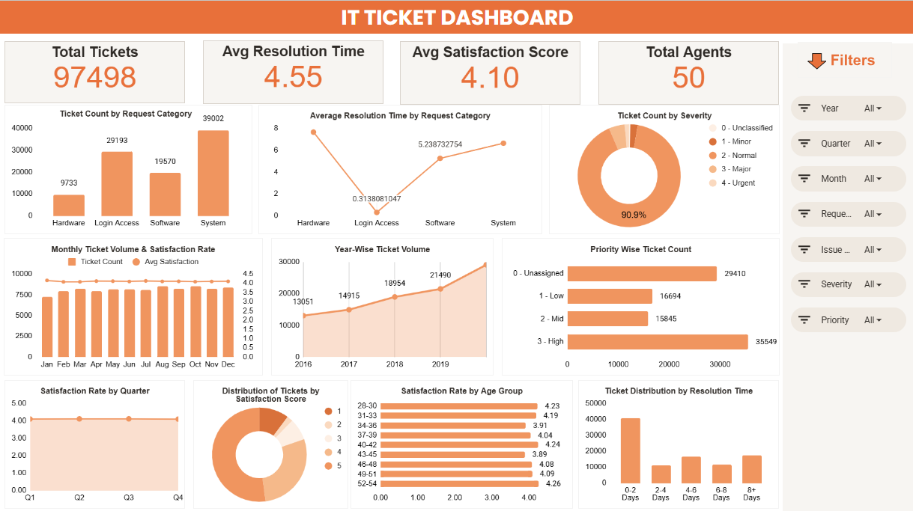

# 📊 IT Ticket Analysis Dashboard

IT Ticket Analysis – Analyze IT support tickets using Google Sheets with data cleaning, Pivot Tables, trend analysis, KPI analysis, interactive charts, and slicers to identify ticket trends, resolution bottlenecks, priority issues, customer satisfaction patterns, and actionable insights for improving IT support efficiency.

### 📂 Project Database & Interactive Dashboard

You can view the complete IT Ticket Analysis Dashboard and dataset here:

🔗 **[View Interactive Google Sheets Dashboard](https://docs.google.com/spreadsheets/d/1wXL67EALsHi_T40NmHa0vWlXqGLkDKWrj2ZNNiY4cyo/edit?usp=sharing)**

# 📋 Overview

This project involves a comprehensive analysis of an IT support ticket management system using a dataset containing **97,498 tickets** handled by **50 IT agents** between **2016 and 2020**.

The primary objective was to understand IT support workload, ticket categories, severity, priority, resolution efficiency, customer satisfaction, agent performance, and trends over time.

The analysis was used to identify operational patterns, performance gaps, and areas where IT support processes could be improved through data-driven recommendations.

# 🚀 Key Objectives

- **Ticket Analysis:** Understand the overall volume and distribution of IT support tickets.
- **Category Analysis:** Analyze tickets across Hardware, Login Access, Software, and System requests.
- **Resolution Efficiency:** Evaluate average resolution time and identify categories with longer resolution times.
- **Priority & Severity Analysis:** Examine how ticket severity and priority levels are distributed.
- **Customer Satisfaction:** Analyze satisfaction scores across different periods and agent-related segments.
- **Agent Performance:** Evaluate agent workload, average resolution time, and satisfaction levels.
- **Trend Analysis:** Identify monthly, quarterly, and yearly patterns in ticket volume and satisfaction.
- **Actionable Insights:** Identify operational bottlenecks and areas requiring improvement.
- **Business Recommendations:** Provide data-driven recommendations for improving IT support efficiency and service quality.

# 📊 Methodology

The analysis was performed using **Google Sheets** with the following steps:

- **Data Cleaning:** Checked for missing values and corrected spelling inconsistencies such as `Unclasified → Unclassified`, `Mayor → Major`, and `Unassiged → Unassigned`.

- **Data Preparation:** Organized ticket data containing Ticket ID, Date, Employee ID, Agent ID, Request Category, Issue Type, Severity, Priority, Resolution Time, and Satisfaction Rate.

- **Derived Columns:** Created additional fields such as Year, Quarter, Month, Age, and Resolution Time Groups to support trend and distribution analysis.

- **Pivot Tables:** Created Pivot Tables to analyze ticket volume, resolution time, satisfaction rate, severity, priority, agent performance, age groups, and time-based trends.

- **KPI Analysis:** Calculated key metrics including total tickets, average resolution time, average satisfaction score, and total agents.

- **Dashboard Development:** Created an interactive dashboard using charts, KPI cards, and slicers.

- **Interactive Filtering:** Added slicers for Year, Quarter, Month, Request Category, Issue Type, Severity, and Priority.

- **Business Analysis:** Converted the analytical findings into business insights and recommendations using the framework of data → finding → insight → recommendation.

# 📈 Key Performance Indicators (KPIs)

- **Total Tickets:** 97,498
- **Average Resolution Time:** 4.55 days
- **Average Satisfaction Score:** 4.10
- **Total IT Agents:** 50
- **Average Daily Ticket Volume:** 53.37 tickets

# 📊 Dashboard Highlights

The interactive dashboard provides insights into:

- Ticket Count by Request Category
- Average Resolution Time by Request Category
- Ticket Count by Severity
- Monthly Ticket Volume and Satisfaction Rate
- Year-wise Ticket Volume
- Priority-wise Ticket Count
- Satisfaction Rate by Quarter
- Distribution of Tickets by Satisfaction Score
- Satisfaction Rate by Age Group
- Ticket Distribution by Resolution Time

The dashboard also includes interactive slicers for:

- Year
- Quarter
- Month
- Request Category
- Issue Type
- Severity
- Priority

# 🔑 Key Insights & Findings

### 🎫 Request Category Analysis

- **System** requests represent the highest ticket volume with approximately **39,002 tickets**.
- **Login Access** requests account for approximately **29,193 tickets**.
- **Software** requests account for approximately **19,570 tickets**.
- **Hardware** requests account for approximately **9,733 tickets**.

System and Login Access requests therefore represent the majority of the overall ticket workload.

---

### ⏱️ Resolution Efficiency

Average resolution time varies significantly across request categories:

- **Hardware:** 7.63 days
- **System:** 6.62 days
- **Software:** 5.24 days
- **Login Access:** 0.31 days

Hardware requests have the highest average resolution time, while Login Access requests have the lowest.

The analysis suggests that Hardware requests should receive additional process attention to reduce resolution delays.

---

### 🚦 Severity Analysis

- Normal-severity tickets account for the highest number of tickets.
- The dataset contains Unclassified, Minor, Normal, Major, and Urgent severity levels.
- Higher-severity tickets require stronger monitoring and escalation processes.

The analysis indicates that severity trends should be monitored regularly, particularly for Major and Urgent tickets.

---

### 📌 Priority Analysis

Priority distribution shows:

- **High:** 35,549 tickets
- **Unassigned:** 29,410 tickets
- **Low:** 16,694 tickets
- **Mid:** 15,845 tickets

A significant number of tickets remain **Unassigned**.

The analysis also indicates that tickets across different severity levels are distributed across multiple priority levels rather than following a consistently aligned assignment pattern.

This creates an opportunity to improve automatic prioritization and escalation processes.

---

### ⭐ Customer Satisfaction

- Overall average satisfaction score is approximately **4.10**.
- Satisfaction remains relatively stable across the analyzed period.
- January records the highest average satisfaction.
- February and March show relatively lower satisfaction levels.
- Quarterly analysis shows a gradual improvement in satisfaction over time.
- Q2 2020 records the highest satisfaction level in the analyzed period.

The overall trend suggests relatively stable customer satisfaction with gradual improvement over time.

---

### 📅 Monthly Ticket Trends

- **August, October, and December** show relatively higher ticket volumes.
- **January** records the lowest ticket volume.
- May, June, and July show relatively stable ticket volumes.
- Satisfaction remains around the overall average of approximately 4.10 with minor fluctuations.

Peak periods should be monitored so that sufficient IT support capacity is available when ticket volume increases.

---

### 📈 Year-wise Ticket Trends

Ticket volume increased significantly from 2016 to 2020:

- **2016:** 13,051 tickets
- **2017:** 14,915 tickets
- **2018:** 18,954 tickets
- **2019:** 21,490 tickets
- **2020:** Approximately 29,088 tickets

The increasing ticket volume indicates a growing demand for IT support over the analyzed period.

However, increased ticket volume alone does not necessarily indicate poor IT performance and should be evaluated together with resolution time, satisfaction, workload, and ticket complexity.

---

### 👨‍💼 Agent Performance

Agent performance was analyzed using:

- Average Satisfaction Rate
- Average Resolution Time
- Number of Tickets Resolved

The analysis identified differences in agent satisfaction and resolution performance.

Some agents showed lower satisfaction scores or higher average resolution times and can therefore be considered for targeted training and performance review.

The available data does not provide sufficient evidence to conclude that any agent should be removed solely based on these metrics.

---

### 👥 Age Group Analysis

Agent performance was also analyzed across age groups using average resolution time and satisfaction rate.

The analysis indicates differences between age groups, but age alone should not be considered a measure of agent performance.

Factors such as experience, technical skills, training, workload, and ticket complexity can also influence performance.

---

### ⏳ Resolution Time Distribution

A **Resolution Time Group** was created to categorize tickets into:

- 0–2 Days
- 2–4 Days
- 4–6 Days
- 6–8 Days
- 8+ Days

This distribution provides additional insight beyond the overall 4.55-day average and helps identify tickets that take significantly longer to resolve.

# 💡 Strategic Recommendations

### 1. Improve Ticket Prioritization

Implement clearer rules for assigning priority based on ticket severity.

Major and Urgent tickets should receive appropriate priority and escalation to reduce delays.

### 2. Reduce Hardware Resolution Delays

Hardware requests have the highest average resolution time.

IT management should review hardware-related workflows, dependencies, and support processes to identify opportunities for reducing resolution time.

### 3. Targeted Agent Training

Provide targeted training and coaching for agents with relatively high resolution times or lower satisfaction scores.

Training should focus on technical troubleshooting, ticket handling, and customer communication.

### 4. Improve Peak-Period Resource Planning

Ticket volumes are relatively higher during August, October, and December.

Staffing and workload allocation can be adjusted during high-volume periods to maintain service quality.

### 5. Monitor Unassigned Tickets

The large number of Unassigned tickets indicates an opportunity to improve ticket assignment workflows.

Automated assignment rules and regular monitoring can help reduce unassigned tickets.

### 6. Continue Satisfaction Monitoring

Customer satisfaction should be monitored monthly and quarterly to identify changes in service quality and maintain the positive trend observed in the analysis.

### 7. Use Data for Continuous Improvement

The dashboard can be regularly updated with new ticket data so that IT management can continuously monitor workload, resolution time, satisfaction, severity, priority, and agent performance.

# 📷 Dashboard Preview



# 📁 Project Structure

```text
IT-Ticket-Analysis-Dashboard/
│
├── Dashboard.png
├── IT_Ticket_Analysis_Presentation.pptx
├── IT_Ticket_Analysis_Documentation.docx
└── README.md
```

### 🔗 Interactive Dashboard

The interactive version of the dashboard is available in Google Sheets:

**[View IT Ticket Analysis Dashboard](https://docs.google.com/spreadsheets/d/1wXL67EALsHi_T40NmHa0vWlXqGLkDKWrj2ZNNiY4cyo/edit?usp=sharing)**

# 🛠 Tech Stack

- **Google Sheets**
- Pivot Tables
- Pivot Charts
- Interactive Slicers
- KPI Analysis
- Data Cleaning
- Data Validation
- Conditional Formatting
- Excel/Google Sheets Functions
- Trend Analysis
- Correlation Analysis
- Data Visualization
- Business Analysis

# 🚀 Skills Demonstrated

- Data Cleaning
- Data Analysis
- Google Sheets Dashboard Development
- Pivot Table Analysis
- KPI Reporting
- Data Visualization
- Trend Analysis
- Customer Satisfaction Analysis
- Agent Performance Analysis
- Operational Analysis
- Business Insight Generation
- Data-Driven Decision Making

# 📚 Business Impact

This analysis can help IT management:

- Monitor IT support workload
- Identify high-volume request categories
- Reduce resolution delays
- Improve ticket prioritization
- Monitor customer satisfaction
- Identify agents requiring targeted support
- Improve resource allocation during peak periods
- Track IT support performance over time
- Make data-driven operational decisions


⭐ **If you found this project useful, consider giving the repository a star!**
